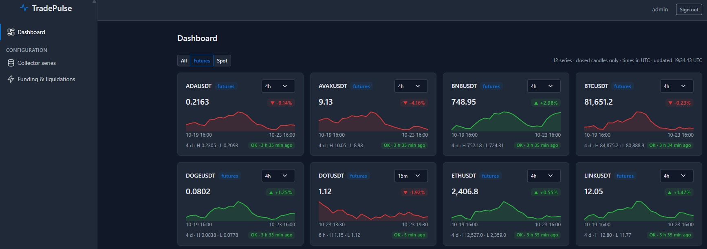

# 📈 TradePulse: Market Data Collector & Analytics Platform

[](https://github.com/shahinMehrzad/TradePulse/actions/workflows/ci.yml)



A .NET 10 / C# 14 project with two purposes: a **reference for how I structure and write code**, and a **real market-data collector** that feeds my own machine-learning trading research.

It continuously collects Binance market data into PostgreSQL, built for speed and reliability on the collection path, with a Clean Architecture around it.

> **Status:** the data collector is the focus and is working. The Web API provides authentication and a read-only candle endpoint; the admin panel (screenshot above) shows what is collected and how fresh it is; event messaging is planned (see the [roadmap](#-roadmap)). Everything listed under "Implemented" exists in the code today.

## ✅ Implemented

### What it collects

| Data | Source | Notes |
| --- | --- | --- |
| **Candles (OHLCV)** | REST | Spot and USD-M Futures, any configured symbol and timeframe from 1s to 1d. Resumes from the newest stored candle, repairs gaps automatically. |
| **Funding rates** | REST | Futures. Full history from a configured start date, polled hourly. |
| **Open interest** | REST | Futures, per period (5m to 1d). Binance only keeps ~30 days of history, so this must run continuously to build a long series. |
| **Liquidations** | WebSocket | Futures. No history exists, so only what arrives while the worker runs is stored. Binance sends at most one liquidation per symbol per second, so this is a sample, not a complete record. |

What makes the collection path fast and safe (details in [docs/collector.md](docs/collector.md)):

- **Idempotent writes:** binary `COPY` into a temp table, then `INSERT ... ON CONFLICT DO NOTHING`, so re-fetching any range is always safe.
- **Rate-limit aware:** one shared weight limiter per market, exponential backoff on failures.
- **Self-healing:** a daily gap detector refills missing candles, and a database error is never mistaken for an empty table.
- **Live candles over WebSocket,** with the REST loop at every candle boundary as the watchdog.
- **Non-blocking liquidations:** the socket callback only enqueues into a bounded `Channel<T>`; one writer drains it in batches.
- **Config-driven:** which series to collect is chosen in the admin panel and stored in the database, no code and no redeploy.

### Architecture

Clean Architecture, dependencies pointing inward:

```
Domain  ←  Application  ←  Infrastructure  ←  BackgroundWorker / WebApi

WebRazor: no project reference at all, it only calls WebApi over HTTP
```

- **Domain:** entities, value objects (`Price`, `TimeRange`), enums, repository interfaces, and the rules every service shares (`TableNameRegistry`, `MarketDataSupport`).
- **Application:** a small hand-written CQRS layer (`ICommandHandler`, `ICommandDispatcher`, handlers discovered by reflection) and the exchange ports (`Application/Exchange`). The worker only uses those ports and never touches Binance.Net directly; an architecture test enforces it.
- **Infrastructure:** Dapper and Npgsql for market data, EF Core with ASP.NET Identity for authentication.
- **WebApi:** JWT login and refresh tokens, the candle read API and the dashboard API ([docs/api.md](docs/api.md)). **WebRazor:** admin panel (sign-in, a dashboard with a page per symbol, and the lists of candle series, funding rates and liquidations to collect), see [Admin panel](docs/admin-panel.md).

### Admin panel

A [Tabler](https://tabler.io)-based panel that only the seeded administrator can enter, and the only place where the collector is configured. The **Dashboard** shows one card per symbol (price, change, sparkline, and how fresh the data is, with a time frame picker per card); a card opens a **symbol page** with a candlestick chart and the funding rate, open interest and liquidations collected for it. Charts are drawn on the server as inline SVG. More: [docs/admin-panel.md](docs/admin-panel.md).

### More documentation

| Page | What is in it |
| --- | --- |
| [docs/collector.md](docs/collector.md) | The data the worker collects and how the collection path is built. |
| [docs/health.md](docs/health.md) | `GET /health` and every check behind it. |
| [docs/alerts.md](docs/alerts.md) | Telegram and email messages when a check changes or a new gap appears. |
| [deploy/README.md](deploy/README.md) | Running Postgres, the API, the panel and the collector with Docker. |
| [docs/configuration.md](docs/configuration.md) | Choosing candle series, open interest, funding rate and liquidations in the database. |
| [docs/api.md](docs/api.md) | The candle read API, the dashboard API, login and refresh tokens. |
| [docs/admin-panel.md](docs/admin-panel.md) | The panel's pages, sessions and what it asks WebApi for. |
| [docs/candle-cache.md](docs/candle-cache.md) | `HybridCache` in front of the candle reads, with benchmark results. |
| [docs/testing.md](docs/testing.md) | Unit, integration and contract tests, benchmarks, CI. |

## 🧩 Design decisions

- **The collector is a separate concern.** It runs as its own service so a bad request elsewhere can never slow or stop data collection. Other services share the same PostgreSQL schema.
- **The schema and enums are a contract.** One table per exchange, market, symbol and timeframe, named by a single registry (`binance_futures_btcusdt_4h`, `binance_futures_btcusdt_fundingrate`, `binance_futures_btcusdt_1h_openinterest`, `binance_futures_btcusdt_liquidation`). Enum numeric values are never renumbered.
- **Time columns are `timestamp` and always UTC.**

## 🚀 Getting started

Requirements: .NET 10 SDK, Docker.

```bash
docker-compose up -d                  # PostgreSQL (plus Redis and RabbitMQ for upcoming features)
dotnet run --project src/WebApi       # creates the schema, seeds the admin (Development), serves the API
dotnet run --project src/WebRazor     # the admin panel, by default on http://localhost:5062
dotnet run --project src/BackgroundWorker
```

Sign in to the panel with the Development admin from [`appsettings.Development.json`](src/WebApi/appsettings.Development.json) and add a series under **Collector series**: **the worker has nothing to collect, and idles, until you do**. A change made later applies by itself within about half a minute; the dashboard then shows each series as its first candles arrive. How the choice is stored and read: [Configuration in the database](docs/configuration.md).

Or everything in containers, with its own database: [deploy/README.md](deploy/README.md).

Run the tests:

```bash
dotnet test --solution DotNetTradePulse.slnx
```

## 🗺️ Roadmap

Planned, not built yet:

- Event publishing (`CandleClosed`) through **RabbitMQ** using an outbox, and **Redis** for latest-candle caching.
- Candle read API extras (streaming, CSV/Parquet export, cache invalidation from `CandleClosed` events instead of TTL).
- Series list in the panel with sortable columns, dropdown filters and a page size (the API side, OData, already exists).
- A dashboard the admin can arrange: card order, a default time frame per card, hiding a card.
- Re-checking recent candles for exchange-side revisions.
- More exchanges and symbols behind a common collector abstraction.
- OpenTelemetry.

## 📄 License

MIT, see [LICENSE](LICENSE).
