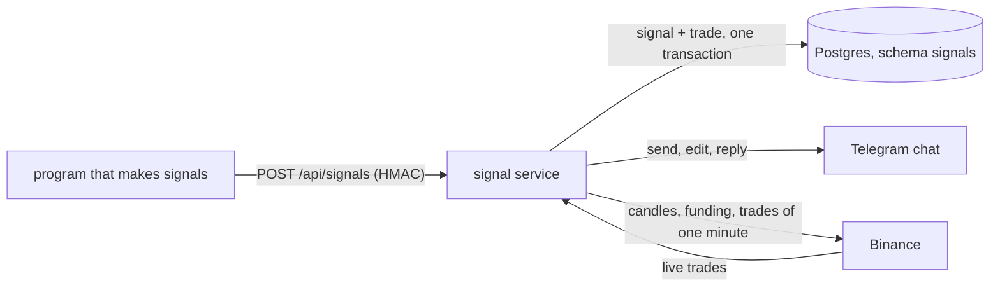

# Signals and paper trades

A program that makes trading signals (it lives outside this repository, and nothing about how it decides is here) sends each signal to a webhook. The
**signal service** (`src/SignalReceiver`, compose service `signals`) judges it, and when it is worth taking opens a **paper trade**: a virtual position that
never touches an exchange. It follows the price until the target or the stop is reached, and tells a Telegram chat: a message when the trade opens,
the same message edited with the result when it ends, and a short reply under it (an edit makes no sound, a reply does).



Why paper trades first: they are the strategy's own record, with no slippage, no refused orders and no admin's limits. When real trading comes
(the key vault, [exchange-keys.md](exchange-keys.md)), it is one more consumer of the same accepted signal; the paper trade goes on beside it.

## Setting it up

1. **Passwords.** In `deploy/.env`: `SIGNALS_DB_PASSWORD` (role `tp_signals`, the service) and, for the program that makes the signals if it reads the stored candles,
   `SIGNAL_SOURCE_DB_PASSWORD` (role `tp_signal_source`, read-only on the data tables). Then `./deploy/main-db-roles.sh` (before the API starts the first time and again after it),
   and `./deploy/check-db-roles.sh`. What each role may do: [database-security.md](database-security.md).
2. **The secret.** `SIGNALS_WEBHOOK_SECRET`: `openssl rand -hex 32`, at least 32 characters. Both sides have it. The service does not start without it.
3. **The chat (optional).** `SIGNALS_TELEGRAM_BOT_TOKEN` and `SIGNALS_TELEGRAM_CHAT_ID`: a bot of its own (@BotFather), added to the chat. Without them the messages are only written to the log.
4. **Start.** `docker compose -f deploy/docker-compose.yml --env-file deploy/.env --profile signals up -d --build`. The service waits for the API (which creates the schema `signals`).
5. **The strategies.** A signal carries only a label (`S1`). A label that has no row is refused (`UnknownStrategy`), so a typo in the sender never trades. Add one:

   ```bash
   docker compose -f deploy/docker-compose.yml exec -T postgres psql -U postgres -d tradepulse -c \
     "INSERT INTO config.signal_strategy_configurations (\"Strategy\", \"IsEnabled\", \"MaxSignalAgeSeconds\", \"MaxMoveOfStopDistance\", \"MaxOpenPerSymbol\", \"MaxLeverage\") \
      VALUES ('S1', true, 3600, 0.25, NULL, 20)"
   ```

   | Column | Meaning |
   | --- | --- |
   | `IsEnabled` | Switch a strategy off with `false`; its row stays. |
   | `MaxSignalAgeSeconds` | How long after its candle closed a signal is still taken (1 s to 7 days). |
   | `MaxMoveOfStopDistance` | How far the live price may be from the signal's price, as a part of the distance from that price to the stop (0.25 = a quarter; more than 0, at most 1). A fixed percent would not do: the levels are absolute, so any move changes the risk to reward. |
   | `MaxOpenPerSymbol` | How many trades of the strategy may be open on one symbol; `NULL` = no limit (overlap is allowed). |
   | `MaxLeverage` | A guard against a typo in the sender (1 to 125). |

   The limits live in the database, so they change without a deploy, and the sender can only ask for something stricter (`validUntil`).
6. **The symbols.** The service follows every Futures symbol listed on the panel's Symbols page, and every symbol with an open trade. A signal for a symbol that is not listed
   is refused (`UnknownSymbol`). A new symbol needs listing only: its candles do not have to be collected.
7. **The sender** joins the network `tradepulse-signals` (declared `external` in its own compose file) and calls `http://signals:8080/api/signals`. It sees nothing else of the stack.
   From this machine: `http://127.0.0.1:8090` (`SIGNALS_PORT`). There is no public port, and none should be made.

## The webhook

`POST /api/signals`, a JSON body, three headers:

| Header | Value |
| --- | --- |
| `X-Timestamp` | The time of this request, UTC, ISO 8601: `2026-11-07T08:00:02Z`. Within five minutes of the service's clock. |
| `X-Signature` | `HMAC-SHA256(secret, X-Timestamp + "." + body)` in lower-case hexadecimal (a leading `sha256=` is allowed). Sign the exact bytes you send. |
| `Idempotency-Key` | The `signalId`, the same as in the body. |

A retry gets a **new** timestamp and a new signature, and the same body and key. Python:

```python
body = json.dumps(signal)                                   # the bytes that are sent
ts = datetime.now(timezone.utc).strftime("%Y-%m-%dT%H:%M:%SZ")
sig = hmac.new(secret.encode(), f"{ts}.{body}".encode(), hashlib.sha256).hexdigest()
requests.post(url, data=body, headers={"X-Timestamp": ts, "X-Signature": sig, "Idempotency-Key": signal["signalId"], "Content-Type": "application/json"})
```

### The body

```json
{
  "signalId": "S1:BTCUSDT:4h:2026-11-07T04:00Z:long",
  "strategy": "S1",
  "exchange": "Binance",
  "market": "Futures",
  "symbol": "BTC/USDT",
  "side": "Long",
  "leverage": 5,
  "takeProfit": 68900.0,
  "stopLoss": 66800.0,
  "signalPrice": 67420.5,
  "timeframe": "4h",
  "candleOpenTime": "2026-11-07T04:00:00Z",
  "candleCloseTime": "2026-11-07T08:00:00Z",
  "validUntil": "2026-11-07T08:45:00Z",
  "maxHours": null
}
```

| Field | Rule |
| --- | --- |
| `signalId` | Built like this and checked: `strategy:SYMBOL:timeframe:candleOpenTime(yyyy-MM-ddTHH:mmZ):side`, symbol without the slash in upper case, side in lower case (`S1:BTCUSDT:4h:2026-11-07T04:00Z:long`). Binance adds nothing; another exchange puts its name in front (`okx:S1:...`). |
| `strategy` | 1 to 32 of letters, digits, `_`, `-`. |
| `exchange` | Optional, `Binance` when left out. |
| `market` | `Futures` (the only one taken). |
| `symbol` | `BASE/QUOTE`, upper case, listed on the Symbols page. |
| `side` | `Long` or `Short`. |
| `leverage`, `takeProfit`, `stopLoss`, `signalPrice` | Numbers above 0. The levels are absolute prices. A long needs stop &lt; price &lt; target, a short target &lt; price &lt; stop. |
| `timeframe` | `15m`, `1h`, `4h`, `1d`, ... |
| `candleOpenTime` | The open time of the **closed** candle that made the signal. A signal that arrives at 08:00:02 carries 04:00 for a 4h candle. |
| `candleCloseTime` | `candleOpenTime` plus the time frame (08:00). The age of the signal is counted from it. |
| `validUntil` | The last moment the sender still wants the signal taken. Stop retrying then. |
| `maxHours` | Optional. The trade ends at its current price after this long if it reached neither level; left out, it stays open until it does. |

Times must carry a zone (`Z` or an offset). Enums are given by name, never by number. Unknown fields are ignored.

### The answers

| Status | Meaning | What to do |
| --- | --- | --- |
| `202` | Taken: a paper trade is open. `{"signalId", "tradeId"}` | Done. |
| `200` | This signal was taken before. `{"signalId", "status": "duplicate"}` | Done. |
| `422` | Refused, with `{"signalId", "reason"}`. | Never send it again: the same signal gets the same answer. |
| `400` | Not the contract (the field is named in `error`), or the key is not the `signalId`. | Fix the sender. |
| `401` | Not proven to be the sender: no or wrong signature, or a time too far from the service's. | Check the secret and the clock. Stop and alert. |
| `413` | The body is larger than 16 KB. | Fix the sender. |
| `503` | Not judged: there is no price of the symbol newer than ten seconds, or the database is down. `Retry-After` says when. | Send again (new timestamp and signature) until `validUntil`. |

The reasons of a `422`: `StrategyDisabled`, `UnsupportedMarket`, `SignalIdMismatch`, `InconsistentCandleTimes`, `LeverageOutOfRange`, `LevelsOnWrongSide`, `SignalFromTheFuture`,
`SignalExpired` (after `validUntil`), `SignalTooOld` (after `MaxSignalAgeSeconds`), `PriceBeyondLevels` (the live price is already at or past a level), `PriceMovedTooFar`,
`TooManyOpenTrades`, `UnknownStrategy`, `UnknownSymbol`. They are checked in this order, and the first that fails is the answer.

A signal is judged **once**. Every signal that gets as far as being judged is stored with its verdict (table `signals.signals`), the refused ones too. A taken signal and its trade are stored in one
transaction, so there is never a taken signal without a trade.

## The paper trade

- **Entry:** the latest trade price of the symbol when the signal is judged. The signal's own price is kept beside it (`SignalPrice`), so the slippage of every trade can be studied later.
- **Exit:** the first price that reaches the target or the stop, **as it was seen**: a price that jumps past a stop closes the trade at that price, not at the stop. A trade ends once.
- **Nothing is guessed.** If the service was stopped or the connection dropped, the stretch nobody watched is looked at afterwards through Binance's 1 minute candles. A candle that tells the order
  (one level reached, or opened beyond one) ends the trade; a candle that holds **both** levels does not: the trades of that minute are fetched and replayed in order. When Binance does not answer,
  the trade stays open and it asks again. The progress of every open trade (how far it has been followed, its best and worst price) is saved every minute, so a restart only looks at what came after.
- **Result:** the move with its leverage, the taker fee of entering and leaving (0.04 % per side), and the funding paid or received while it was open, asked of Binance for the trade's own stretch.
  A trade that ended in the first two minutes after a full hour waits until the funding settlement it may have paid is published. Costs are shown as what they did to the result.
- **The message** (English): `Paper trade opened`, then `Target hit` / `Stop hit` / `Expired` with entry, exit, duration, result with leverage, exchange fees, funding, exchange cost (fees + funding),
  net result, the worst drawdown on the way and R. A message that was deleted is replaced by a new one with the whole story. When the chat says "too many requests" the service waits.

## Operating it

- **Logs:** `docker compose -f deploy/docker-compose.yml logs signals`. Every signal, refusal and end of a trade is a line; secrets are never in a log or an error.
- **The record:** `signals.signals` (what was received and decided), `signals.paper_trades` (the trades, with their results and the message ids), `signals.events` (opened, refused, message sent, edited, failed).
  Open trades: `SELECT * FROM signals.paper_trades WHERE "Status" = 1`. Refusals: `SELECT "SignalId", "Rejection" FROM signals.signals WHERE "Rejection" IS NOT NULL`.
- **Restarts lose nothing:** open trades are loaded and caught up; a trade that is open without a message, or that ended without its end being told, is found again at the start and every 30 seconds.
- **Changing the secret:** put the new one in `SIGNALS_WEBHOOK_SECRET` and the old one in `SIGNALS_WEBHOOK_PREVIOUS_SECRET`, restart, change the sender, then empty the previous one.
- **Health:** `GET /health` (answers 200 when the program is up).

## Limits, and what is not done

- Nothing here has talked to the real Binance or Telegram in production use; the tests use scripted answers in the shape the APIs document. Watch the first real signals.
- The entry price is the latest price at the moment of judging, not "the first price after the signal".
- Real (not paper) trading is not part of this: it is a later consumer of the accepted signal, with each admin's own rules (strategy and symbol filters, keys, limits) in the key vault.
- Admin pages for the strategy settings do not exist yet: use the SQL above.
- Only Binance USD-M futures. A second exchange needs an adapter for the ports in `src/Application/Exchange` and its name in the optional `exchange` field.
